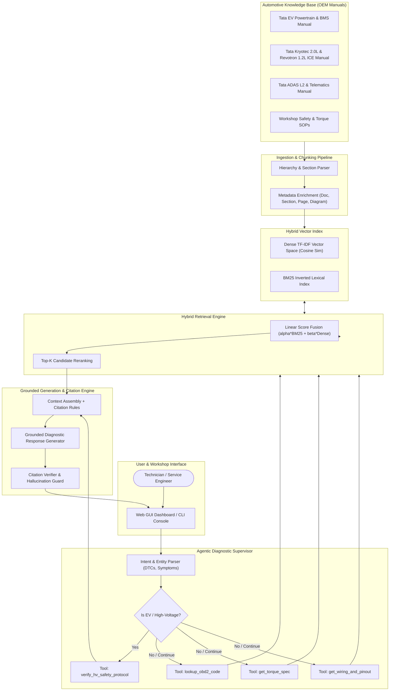
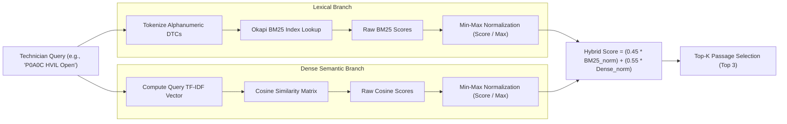
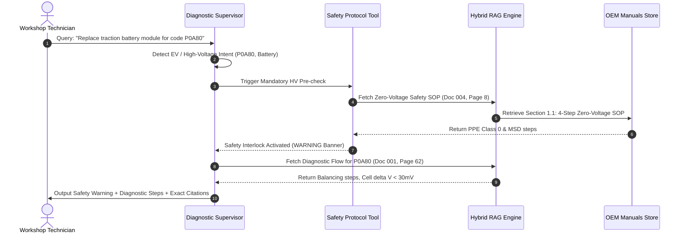

# AUTODIAGNOSTIX-AI: ARCHITECTURE DIAGRAMS & DATA FLOWS

This document visualizes the complete end-to-end architecture, hybrid retrieval fusion, and agentic decision tree of **AutoDiagnostix-AI**.

---

## 1. End-to-End System Architecture

---

## 2. Hybrid Retrieval & Score Fusion Flow

---

## 3. High-Voltage Safety Interlock Decision Sequence

